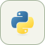
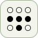
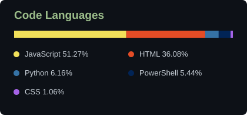

  

 

### 👋 About Me

**Python으로 접근 로그를 분석하고, 이상행위를 탐지하는 자동화 기능을 구현했습니다.**  
SKT ALEPH 캡스톤에서 로그 수집·정규화와 탐지 규칙 구현, Linux VM 배포·대응 연계 검증을 담당했습니다. 교육 과제에서는 **Claude를 활용한 구현·실행 결과 검토·수정 범위 판단**을 경험했습니다.

<pre>접근 로그 → 수집·정규화 → Python 규칙·위험 점수 → 팀 대응 기능 → pfSense 차단
            └────── 개인 구현·VM 배포 ──────┘   └── 연계·결과 검증 ──┘</pre>

### 🛡️ Featured Projects

<table>
<thead><tr><th width="32%">Project &amp; Core Domain</th><th width="48%">Problem &amp; Solution</th><th width="20%">Direct Links</th></tr></thead>
<tbody>
<tr>
<td valign="top"><h3>🛡️ ASTRA</h3>
<b>Python 이상행위 탐지 자동화 로그 수집·정규화·위험 점수</b>

       
<small>SKT ALEPH · 4인 캡스톤 탐지 구현·VM 배포·대응 연계 검증 담당</small></td>
<td valign="top"><ul><li><b>핵심 구현:</b> 브루트포스·퇴사자 계정·권한 밖 접근·SQL Injection 패턴을 판별하고 위험 점수·근거를 이벤트로 정리.</li><li><b>Challenge:</b> 동일 접근의 탐지 근거가 분리돼 70점·15점으로 표시되는 문제.</li><li><b>Solution:</b> 동일 원본 접근의 근거를 합산해 <b>85점 단일 이벤트</b>로 표시하고, 다른 접근은 분리하도록 검증.</li></ul>
<b>검증:</b> 실제 시연 4편 · 공개본 재현 6사례 · 자동 검증 16개.
</td>
<td align="center">       </td>
</tr>
<tr>
<td valign="top"><h3>🔒 ZTNA · XDR</h3>
<b>AI 활용 보안 과제 웹 접근통제·경보 판정·PC Agent</b>

      
<small>SKT ALEPH 교육 과정 과제 AI 활용 구현·실행 결과 검토·수정 범위 판단</small></td>
<td valign="top"><ul><li><b>수행 범위:</b> 비밀금고 웹 접근통제, 교육용 XDR <b>6유형 판정</b>, PC 보안 Agent 학생 확장.</li><li><b>Challenge:</b> 미연결 서비스를 정상으로 표시하거나, 수정본 반영 여부·실패 원인이 불분명한 상태.</li><li><b>Solution:</b> 미연결 상태를 <b>‘확인 불가’로 구분</b>하도록 판단하고, 실행·재제출과 커밋·Push 반영·안내 문서까지 확인.</li></ul>
<b>기여:</b> AI가 코드 작성을 지원하고, 본인이 실행·결과 검토·수정 범위와 대안 선택을 수행.
</td>
<td align="center">       </td>
</tr>
</tbody>
</table>

<b>ASTRA 실제 탐지 화면 보기</b>

각 시연 영상에서 발췌해 모은 실제 콘솔 화면입니다.

ASTRA의 **권한 회수·방화벽 대응·AI 보고서는 팀원이 담당**했습니다. 개인 담당 코드와 공개 재현용 보조 자료는 [원본·공개 범위](https://github.com/Nugury-code/ASTRA/blob/main/docs/SOURCE_SCOPE.md)에 구분했습니다.

### 🧰 Tech & Tools

<h4>Python · 로그 분석 · 데이터</h4>

  

<h4>서버 · 가상화 · 대응 연계</h4>

    

<h4>교육 과제 · 웹 접근통제 · 배포</h4>

     

<h4>AI 활용 · 버전 관리</h4>

  

프로젝트·교육 과제에서 **AI·문서·작업 기록을 참고해 활용한 도구**입니다. [각 도구로 수행한 작업](https://nugury-code.github.io/seokyeon-portfolio/#skills)을 포트폴리오에 정리했습니다.

### 📊 GitHub Activity

<table><tr>
<td width="54%"></td>
<td width="46%"></td>
</tr></table>

2026.11.27 공개 활동 스냅샷 · [집계 원본](https://github-stats-extended.vercel.app/api?username=Nugury-code&amp;show_icons=true&amp;hide_rank=true)  
코드 언어 분포는 공개 저장소의 구성입니다.

### 🎓 Education & Verification

| SKT ALEPH | 수료·확인 내역 |
| --- | --- |
| 교육 기간 | 2026.08.11–2026.11.12 |
| 과정 성과 | **Class Top · 케테르 최고 등급** |
| 평가·출석 | **전국 수강생 132명 중 14위 · 출석률 100%** |
| 근거 | [공개용 교육 인증서](https://nugury-code.github.io/seokyeon-portfolio/assets/certificates/aleph-certificate-public.pdf) |
| 코드 재현 | [ASTRA Python 3.12·3.13 자동 검증](https://github.com/Nugury-code/ASTRA/actions/workflows/verify.yml) |

<b>이전 경험 · 영상 편집 프리랜서</b>

고객 요구 확인, 수정 피드백 반영, 필요한 기능의 독학·적용을 경험했습니다.

---

<b>보안 · IT 기술지원 · 운영 · QA</b> 전국 근무 가능  
<a href="https://nugury-code.github.io/seokyeon-portfolio/">포트폴리오</a> · <a href="mailto:nuguly6248@naver.com">nuguly6248@naver.com</a>

